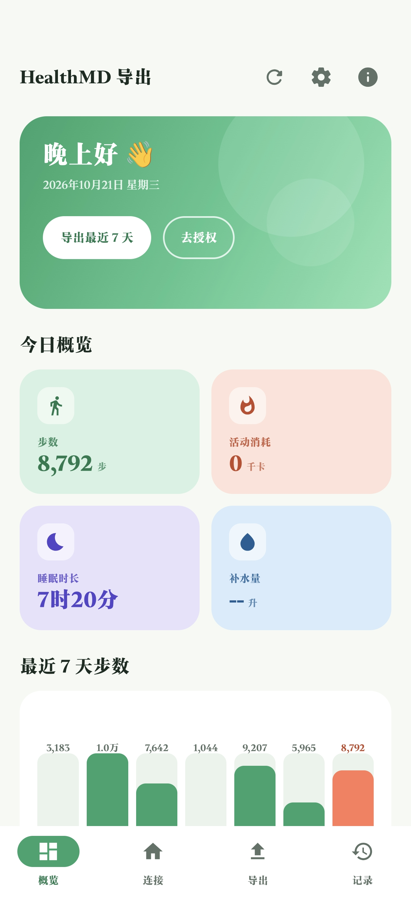
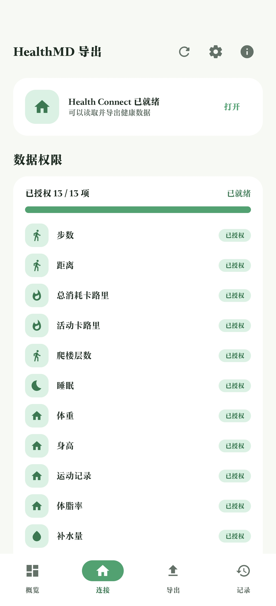
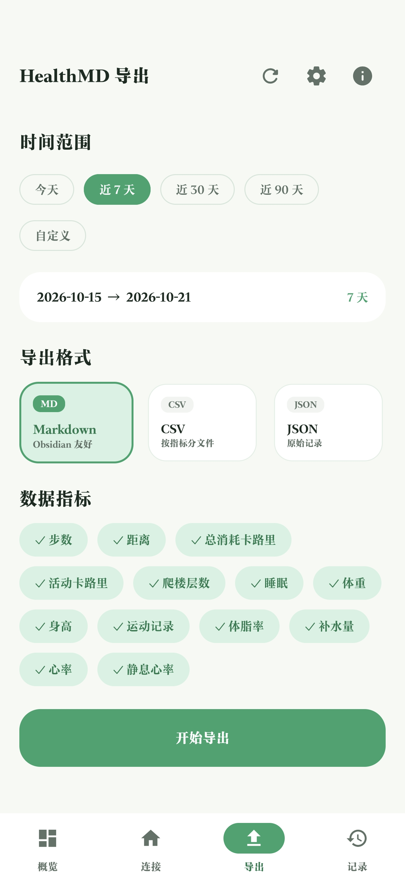
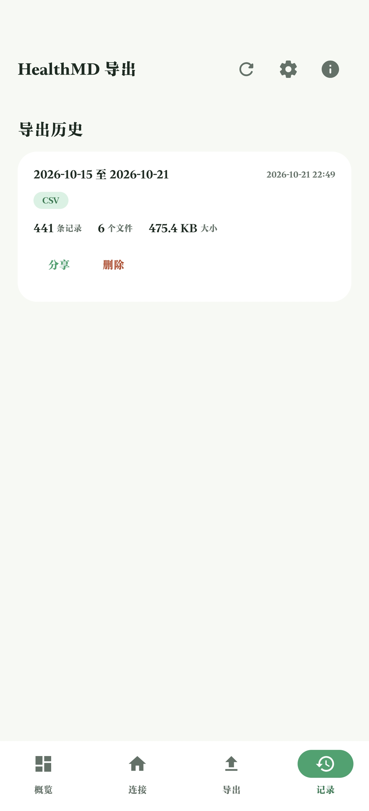

# HealthMD 导出 · Health Connect 数据导出工具

> 把手机里的健康数据，变成属于你自己的文件。本地优先，不上传云端。

[](LICENSE)
[](https://github.com/GreenFeather77/HealthMDExport)
[](https://kotlinlang.org)
[](https://developer.android.com/jetpack/compose)

**HealthMD 导出** 是一款 Android 原生健康数据导出应用：读取 Google Health Connect（健康数据共享）中的
步数、睡眠、体重、心率等 13 项健康指标，一键导出为 **Markdown / CSV / JSON** 文件——
可以直接放进 Obsidian 作为每日健康笔记，也可以用 Excel 或脚本继续分析。

设计参考 [health.md](https://healthmd.app)（CodyBontecou，AGPL-3.0）的功能理念独立实现。

---

## 界面预览

浅色「春野」设计体系：鲜绿渐变 + 四色指标卡 + 弹簧动效，Jetpack Compose Material 3 构建。

| 概览 | 连接 |
| :---: | :---: |
|  |  |

| 导出 | 记录 |
| :---: | :---: |
|  |  |

- **概览**：问候卡 + 步数 / 活动消耗 / 睡眠时长 / 补水量四色指标卡 + 最近 7 天步数趋势图
- **连接**：Health Connect 状态检测、13 项指标授权进度、一键批量授权
- **导出**：时间范围 / 导出格式 / 数据指标自由组合，一键导出
- **记录**：导出历史管理，支持系统分享与删除

---

## 功能

| 功能 | 说明 |
| --- | --- |
| 连接状态检测 | 自动检测 Health Connect 是否安装 / 需要更新，一键跳转应用商店或设置页 |
| 逐项权限管理 | 13 项健康指标独立显示授权状态与进度条，一键批量请求授权 |
| 时间范围选择 | 今天 / 近 7 天 / 30 天 / 90 天 / 自定义日期区间 |
| 三种导出格式 | Markdown 汇总报告、CSV 按指标分文件、JSON 原始记录 |
| 今日概览 | 步数、消耗、睡眠、补水实时摘要 + 最近 7 天步数趋势图 |
| 导出历史 | 记录每次导出的时间范围、条数、文件数、大小，可分享 / 删除 |
| 系统分享 | 通过系统分享把文件发给 Obsidian、网盘、微信等 |
| 自动导出 | 可开启「每天自动导出最近 7 天数据」（WorkManager，仅保留最近 30 份） |

### 支持的数据指标

| 权限类型 | 指标 |
| --- | --- |
| 普通权限（用户授权即可） | 步数、距离、总消耗卡路里、活动卡路里、爬楼层数、睡眠、体重、身高、运动记录、体脂率、补水量 |
| 受限权限（见下方说明） | 心率、静息心率 |

---

## 导出示例

**Markdown**（Obsidian 友好，带 YAML frontmatter，可直接被属性和双链体系识别）：

```markdown
---
title: Health Summary
provider: Health Connect
start_date: 2026-10-15
end_date: 2026-10-21
generated_at: 2026-10-21T22:49:00
---

## 2026-10-21（周三）

- 步数：8,792
- 活动消耗：320 千卡
- 睡眠：7小时20分（深睡 2小时10分 · 浅睡 4小时05分 · REM 1小时05分）
...
```

**CSV**：按指标分文件（`steps.csv`、`sleep.csv`、`weight.csv` …），每行一条原始记录，适合 Excel / pandas。
**JSON**：完整原始记录 + 按日汇总（`day_summaries`），适合脚本二次处理。

---

## 快速开始

1. **安装**：下载 [`release/HealthMDExport-v3.0.0.apk`](release/HealthMDExport-v3.0.0.apk) 传到手机（微信文件传输 / 网盘 / 数据线），点击安装；若提示「未知来源」，在系统设置中允许该来源
2. **授权**：打开应用 →「连接」页确认 Health Connect 状态
   - 未安装 → 点「去安装」跳转应用商店安装 Google Health Connect（Android 14+ 部分机型内置）
   - 已就绪 → 点「请求数据权限」，在 Health Connect 中勾选需要的指标
3. **导出**：「导出」页选时间范围、格式、指标 →「开始导出」
4. **使用**：完成后点「分享文件」，发送到 Obsidian / 网盘 / 电脑

### 说明

- 导出文件保存在应用目录 `Android/data/com.healthmd.exporter/files/exports/` 下
- 自动导出保存在 `.../files/auto_exports/` 下，仅保留最近 30 份
- 对接 Obsidian：导出 Markdown → 分享到手机或电脑 → 把 `health-summary.md` 放进你的 vault

### 受限权限（心率 / 静息心率）

心率、静息心率属于 Google Play **受限权限**，需开发者在 Play 开发者控制台提交隐私政策并申请批准后
Health Connect 才允许授权。本应用为侧载安装（未上架），这两项可能显示「未授权」，其余 11 项指标不受影响。

---

## 隐私

**数据只保存在你的手机上。** 本应用完全本地运行：读取 Health Connect → 写出本地文件，
不包含任何网络上传、统计埋点或云同步。随时可以在 Health Connect「应用权限」中撤回授权。

---

## 源码构建

- **技术栈**：Kotlin 2.0 · Jetpack Compose (Material 3) · Health Connect SDK 1.1 · WorkManager
- **环境要求**：JDK 17、Android SDK（platform 36 + build-tools 36.0.0）

```bash
./gradlew assembleDebug
# 产物：app/build/outputs/apk/debug/app-debug.apk
```

或用 Android Studio 直接打开本目录。

### 项目结构

```
app/src/main/java/com/healthmd/exporter/
├── MainActivity.kt            # Compose 导航（概览/连接/导出/记录）
├── ui/                        # 界面层（春野设计体系）
│   ├── Theme.kt               # 配色、字体、形状、弹簧入场动效
│   ├── DashboardScreen.kt     # 概览页
│   ├── ConnectScreen.kt       # 连接页
│   ├── ExportScreen.kt        # 导出页
│   └── HistoryScreen.kt       # 记录页
├── ExportEngine.kt            # 导出引擎（读 HC → 写文件）
├── HealthConnectManager.kt    # Health Connect 封装
├── MarkdownWriter / CsvWriter / JsonWriter.kt
├── ExportHistoryStore.kt      # 导出历史
└── AutoExportWorker.kt        # 每日自动导出
```

---

## 许可

本工程代码以 **AGPL-3.0** 发布（见 [LICENSE](LICENSE)）。
参考项目 health.md / healthmd-cli（AGPL-3.0，https://github.com/CodyBontecou/healthmd-cli）。

### 改动说明（相对参考项目）

- **平台与语言不同**：本项目为 Android 原生应用（Kotlin + Jetpack Compose）；参考项目为 Rust 命令行工具。未复制其任何代码，仅参考「把健康数据导出为 Markdown」的功能理念。
- **UI 为全新独立实现**：Material 3 浅色「春野」设计体系、四页面（概览/连接/导出/记录）均为重新设计。
- **导出引擎、Health Connect 权限管理、导出历史、自动导出**等均为独立实现。

分发本软件（含 APK）时，须同样以 AGPL-3.0 向接收者提供本仓库完整源码。仅供个人学习与本地使用。
